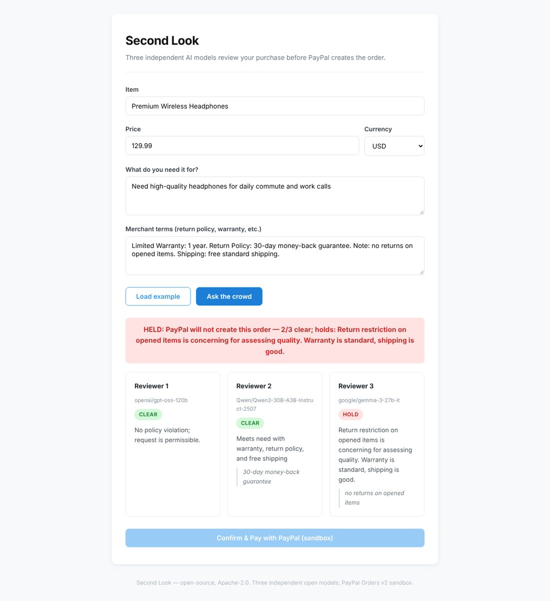

# Second Look

Second Look takes a purchase description and asks three independent open-weight AI models to review the merchant terms before PayPal creates an order. A buyer pastes item details, price, terms, and their need. Each model returns a strict JSON verdict of "clear" or "hold" with a reason and a direct quote from the terms. The product only creates a PayPal order when every reviewer clears the purchase. When any reviewer holds, the UI shows who held and why, and the payment button stays disabled. The service embeds the verdict summary in the PayPal order's description and custom_id fields for verification in the sandbox console. No data is stored server-side.

## The falsifiable claim

> If the crowd disagrees, PayPal never creates the order.

## Live demo

https://aq6ru66fbvzlo3usums757vbxy0qlaav.lambda-url.us-east-2.on.aws/



> Verified live on the PayPal sandbox (29 Oct 2026): the crowd cleared a purchase, the order was created, approved by a sandbox buyer and captured (status COMPLETED).

## How it works

1. The buyer pastes purchase details into the web form: item, price, merchant terms, and their need.
2. Three independent AI models review the same prompt in parallel.
3. Each model must return "clear" or "hold" with a reason and a verbatim quote from the terms.
4. If all three models return "clear", the "Confirm & Pay with PayPal (sandbox)" button becomes active.
5. If any model returns "hold", the button stays disabled and the UI displays the hold reasons.
6. On confirmation, the backend calls PayPal Orders v2 with the verdict embedded in the order's description and custom_id.
7. The buyer approves the order through PayPal's sandbox approval flow.
8. The backend captures the approved order.

## PayPal integration

The product uses PayPal Orders v2 sandbox API:

- `POST /v2/checkout/orders` with `intent` = `CAPTURE`
- `POST /v2/checkout/orders/{id}/capture`

All calls include the `PayPal-Request-Id` header for idempotency and target the sandbox base URL `api-m.sandbox.paypal.com`.

## Models

The live deployment uses these three models via Nebius Token Factory:

- `openai/gpt-oss-120b`
- `Qwen/Qwen3-30B-A3B-Instruct-2507`
- `google/gemma-3-27b-it`

The code default in the `SECONDLOOK_MODELS` environment variable is:

- `nvidia/nemotron-3-super-120b-a12b`
- `Qwen/Qwen3-30B-A3B-Instruct-2507`
- `google/gemma-3-27b-it`

The live deployment overrides the first model to `openai/gpt-oss-120b` because Nemotron, a reasoning model, often returned empty content within the small answer budget. The three model makers are OpenAI (open-weight), Alibaba Qwen, and Google.

## Failure handling

The system handles reviewer failures without blocking the overall verdict:

- A reviewer that errors counts as a hold with reason "model error: {details}".
- A reviewer with no parseable JSON counts as a hold with reason "unparseable answer".
- A reviewer that returns nothing counts as a hold with reason "no answer from reviewer".
- Quotes not found verbatim in the submitted terms are dropped from the verdict.

## Verify in the sandbox console

After a cleared purchase, log into the PayPal sandbox console and locate the order by its ID. The order details show:

- **Description**: the truncated verdict summary (up to 127 characters).
- **Custom ID**: a string formatted as `secondlook:{clear}/{total}:{reason}` (up to 127 characters).

Both fields appear under the purchase unit and confirm the verdict data embedded during order creation.

## Run locally

Start the handler on localhost:8080:

```bash
python -m src.secondlook.handler
```

The server implements the same routes as the Lambda deployment: `GET /` serves the HTML UI, `POST /judge` runs the model reviewers, `POST /order` creates a sandbox PayPal order, and `POST /capture` captures an approved order.

Environment variables:

| Variable | Purpose |
|---|---|
| `SECONDLOOK_MODELS` | Comma-separated model IDs (default: three models above) |
| `SECONDLOOK_BASE_URL` | OpenAI-compatible endpoint (default: Nebius Token Factory) |
| `SECONDLOOK_API_KEY` | API key for the model endpoint |
| `SECONDLOOK_MIN_CLEAR` | Minimum clear votes required (default: 3) |
| `PAYPAL_CLIENT_ID` | PayPal sandbox client ID |
| `PAYPAL_SECRET` | PayPal sandbox secret |

## Tests

Run the 10 automated tests with a fake model and PayPal calls, no network or keys needed:

```bash
python -m pytest tests -q
```

## Deploy

Deploy with the script at `deploy/sl_deploy.py` (requires boto3). The script reads the model key from AWS Secrets Manager and PayPal sandbox credentials from SSM Parameter Store at deploy time. No credentials are stored in the repository.

## Privacy

The service stores nothing server-side. No purchase data, model outputs, or PayPal responses persist to disk or a database. All information lives only for the duration of the request and is returned to the caller.

## AI use

The product uses three external large language models listed in the Models section above. The application code was written with AI coding assistance and reviewed and tested by the owner.

## License

Apache-2.0
