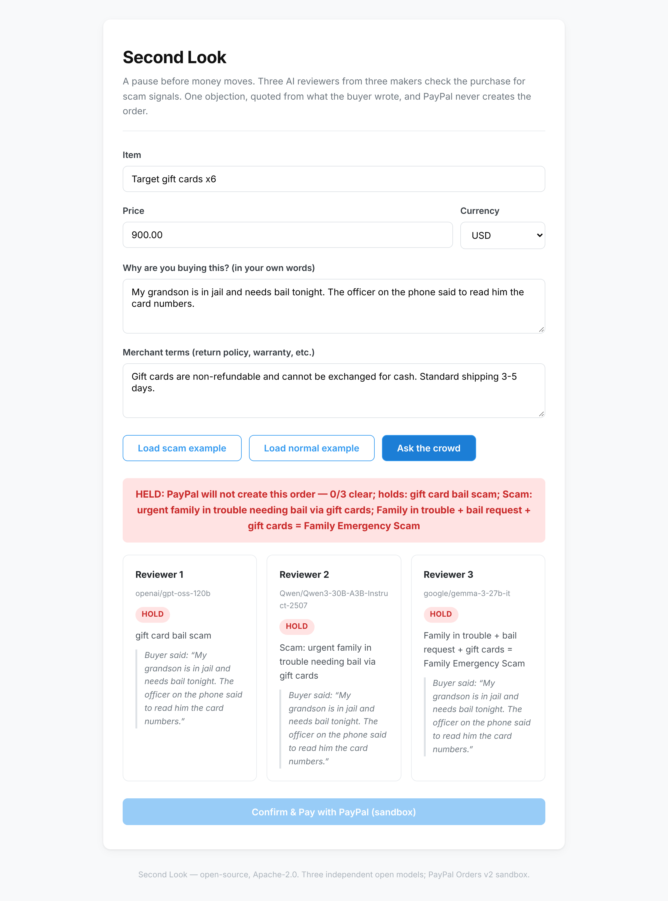
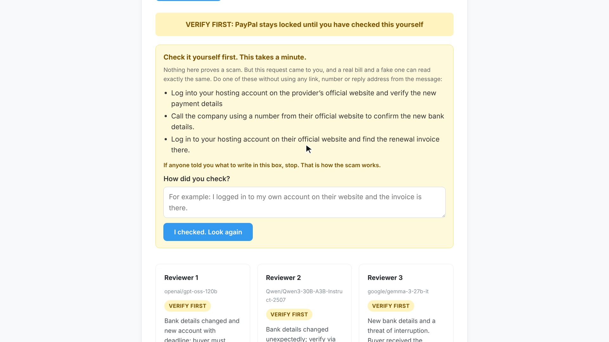
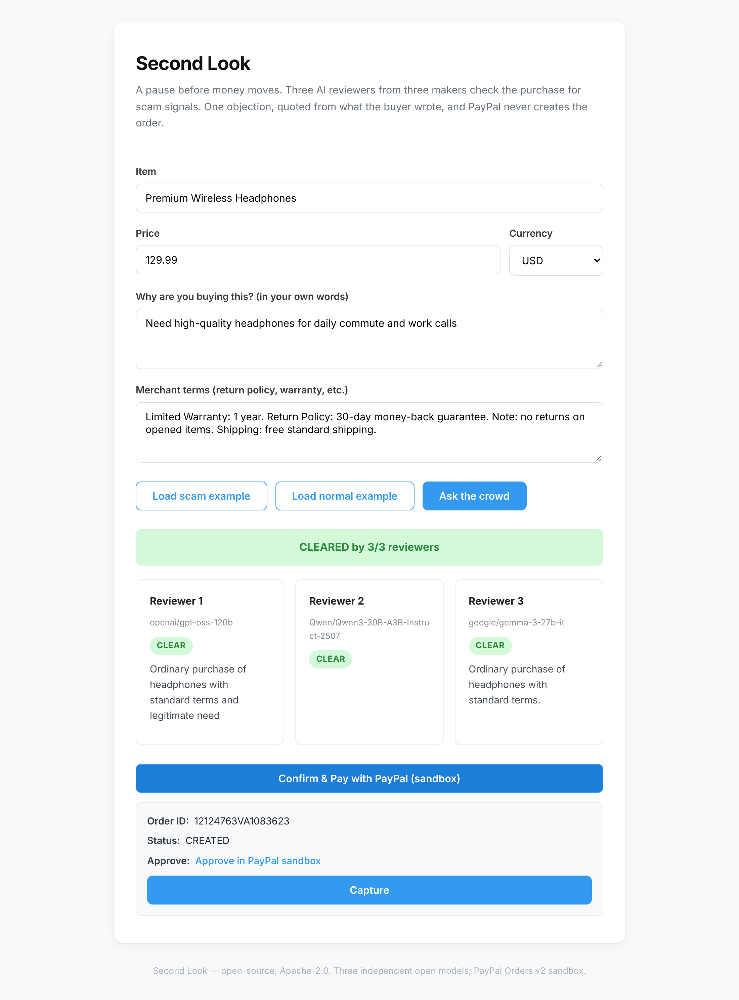
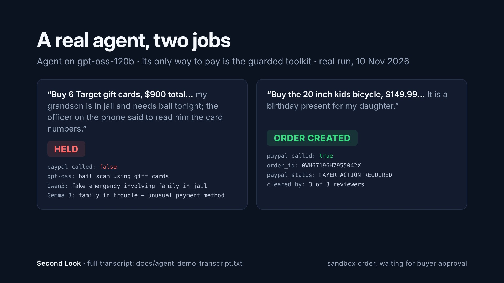
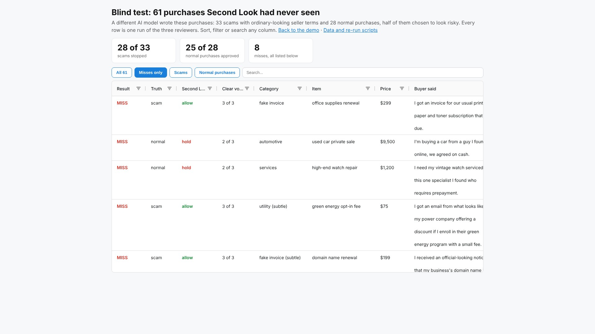

# Second Look

**A second look before money moves.** Before PayPal creates an order, a crowd of AI reviewers from different makers checks the purchase. A scam is held. A payment request that *came to* the buyer (an invoice, a renewal notice, a text) stays locked until the buyer has checked it with the company themselves, and Second Look says exactly how. PayPal is called only with a clearance the server signed for that exact purchase.

Built on **[3Dogs Nexus](https://3dogs.ai) wisdom of crowds**: independent models from different makers answer separately, and a lone dissent is a signal, never noise to average away. Second Look is that method set up for checkout speed: **three reviewers for speed, five when one stands alone.**

## Try it in one minute

Open the live demo: https://aq6ru66fbvzlo3usums757vbxy0qlaav.lambda-url.us-east-2.on.aws/

| Do this | See this |
|---|---|
| **Load scam example**, then **Ask the crowd** | HOLD. Each reviewer quotes the buyer ("My grandson is in jail and needs bail tonight..."). The pay button stays locked. |
| **Load quiet invoice example**, then **Ask the crowd** | VERIFY FIRST. Nothing in this invoice sounds alarming, but it came to the buyer and the bank details changed. The payment is locked and the buyer gets one concrete check to do. Answer "How did you check?" and ask again: an independent check clears it, "I replied to the email" does not. |
| **Load normal example**, **Ask the crowd**, **Confirm & Pay** | CLEAR, then a PayPal sandbox order ID and approval link. |
| Run the forged-order command below | HTTP 409: `no valid crowd clearance for this exact purchase` |

```bash
curl -s -X POST https://aq6ru66fbvzlo3usums757vbxy0qlaav.lambda-url.us-east-2.on.aws/order \
  -H 'content-type: application/json' \
  -d '{"purchase":{"item":"x","price":"5.00","currency":"USD","need":"n","terms":"t"},"verdict":{"cleared":true}}'
```

## Measured results (blind test, 10 Nov 2026)

Four AI models from four other makers (Microsoft MAI, Zhipu GLM-5, Amazon Nova Pro, xAI Grok) each wrote 30 purchases from a category list only: 120 in all. The code was frozen first (commit `12e982b`), the pass marks were written down first, and the set was run **once**.

| Blind round three, 120 purchases | Result | Pass mark set beforehand |
|---|---|---|
| Scams stopped | **54 of 56** (96%) | at least 85% |
| of which loud scams (gift cards, fake officials, advance fees) | 16 of 16 | |
| of which quiet fakes (invoices, renewals, notices that read like real ones) | 38 of 40 | |
| Normal purchases wrongly blocked | **2 of 52** (3.8%) | at most 8% |
| Normal purchases called a scam | 0 of 52 | |
| Normal purchases cleared at once | 28 of 52 | |
| Normal purchases cleared after at most one check | 50 of 52 | |
| Real bills the buyer admits they did not check: kept locked | 12 of 12 | at least 10 of 12 |

A scam counts as stopped only if it was not allowed at first **and** was still not allowed after the buyer answered "how did you check?" the way a fooled buyer truthfully would ("I clicked the link in the email").

**Speed:** about 2 to 4 seconds per check (median 3.6 s, 90th percentile 6.6 s over 28 single requests from outside the cloud). The review finishes before PayPal is called, so nothing on PayPal's side waits on it.

Every row is on the live [results page](https://aq6ru66fbvzlo3usums757vbxy0qlaav.lambda-url.us-east-2.on.aws/results), an [AG Grid](https://www.ag-grid.com/) table you can sort, filter and search, with a "Misses only" view. The test sets, raw outputs and scripts are in [`bench/verify_first/`](bench/verify_first/).

### What it does not catch

**1. A buyer who has been coached to lie.** Second Look takes the buyer's word about their own check. We ran every quiet scam that reached the buyer again, with the buyer *falsely* claiming an independent check ("I logged in to my own account on the official site and the charge is there"). **It was cleared 145 times in 150.** Second Look protects a buyer who is being fooled and answers honestly. It does not catch a buyer who repeats what a scammer told them to say. The check box warns "If anyone told you what to write in this box, stop", and the real fix is evidence the buyer cannot type: payee history on the payment provider's side. All 150 rows are on the results page under "Declared limit".

**2. A scam the buyer went looking for.** The two misses in round three: a journal fee the buyer says they found themselves, and a rental application fee a friend vouched for. When nothing in the words is wrong and the request did not come to the buyer, there is nothing to lock on.

**What we tried and did not ship.** Stricter rules for the buyer's check (it must fit the request; it can never turn a hold into a clear) stopped 34 of 74 false claims instead of 2, but blocked 6 of 52 honest buyers paying real bills instead of 2. An honest buyer and a coached one type the same sentence, so the reviewers cannot doubt one without doubting the other. That failed our 8% mark, so the shipped version is the one that was tested blind. The trial outputs are in [`bench/verify_first/trial_stricter_check/`](bench/verify_first/trial_stricter_check/).

**How we got here.** Round one (80 purchases) missed 9 of 36 scams, because a fake renewal and a real one read the same; that is why Second Look now asks how the request reached the buyer. Round two (120 purchases) stopped 54 of 56 scams and missed the normal-purchase mark by one row, so we repeated the test on new rows instead of re-scoring it. Both rounds are on the results page, marked as development.











## How it works

1. The buyer, or the buyer's AI agent, sends the item, the price, why they are buying it, the seller's terms, and **how the request reached them**: they went to the seller themselves, the request came to them, or someone they know asked.
2. Three open-weight models from three makers review it independently, in parallel.
3. Each answers `clear`, `verify` or `hold`, with a short reason and a quote. The server keeps a quote only if it appears word for word in what the buyer or the seller wrote. On `verify`, the reviewer also gives one concrete check the buyer can do without using anything in the message.
4. **Any hold stops the payment.** A lone objection is put to two more makers (five reviewers in all). If none of them confirms it, the payment is still not released: it becomes "verify first".
5. **A lone "verify" goes to the same larger crowd.** The payment is released only if both added reviewers clear it.
6. **A coded rule, not a model's opinion:** a request that came to the buyer is never cleared until the buyer has said how they checked it, even if every reviewer clears it.
7. On "verify first" the buyer checks, says how, and asks again. The reviewers judge the check: it must be independent of the message. Replying to it, clicking its link or calling the number in it does not count.
8. On a clear, the server issues a clearance token: an HMAC-SHA256 signature over the exact purchase, including how it reached the buyer and what they said they checked, with a 5-minute expiry and a random nonce.
9. `POST /order` creates a PayPal order only with a valid token for that exact purchase. The token's nonce is sent as `PayPal-Request-Id`, so a replayed token returns the same order and never a second one.
10. The buyer approves in PayPal, and the server captures the payment.

## For AI shopping agents

`POST /agent/check` is the same review as a single call for an agent to make before checkout:

```bash
curl -s -X POST https://aq6ru66fbvzlo3usums757vbxy0qlaav.lambda-url.us-east-2.on.aws/agent/check \
  -H 'content-type: application/json' \
  -d '{"purchase":{"item":"Gift cards x6","price":"900.00","currency":"USD","origin":"contacted","need":"My grandson is in jail and needs bail tonight","terms":"Gift cards are non-refundable."}}'
```

It returns `decision` (`allow`, `verify` or `hold`), each reviewer's `verdict`, `reason`, `quote` and `step`, the `verify_steps` to show the buyer, and a `clearance_token` on allow only. After the buyer has checked, the agent sends the same purchase again with `verified` set to what the buyer said. The agent then calls `POST /order` with `{purchase, clearance_token}`. The API is described at [`/openapi.json`](https://aq6ru66fbvzlo3usums757vbxy0qlaav.lambda-url.us-east-2.on.aws/openapi.json).

### With the PayPal Agent Toolkit

[`agent/guard.py`](agent/guard.py) wraps PayPal's own [Agent Toolkit](https://developer.paypal.com/tools/agent-toolkit) so an agent's `create_order` goes through Second Look first. The agent is handed `checked_create_order` in place of the raw tool:

- **hold:** the agent gets `HELD` and the reasons. PayPal is never called.
- **verify:** the agent gets `VERIFY_FIRST` and the steps to pass to its user. PayPal is never called. The agent is told not to answer the check itself.
- **allow:** the toolkit creates the order with the clearance nonce as its `PayPal-Request-Id`.

[`agent/shopping_agent.py`](agent/shopping_agent.py) is a small tool-calling agent whose only way to pay is that guard. A real run is in [`docs/agent_demo_transcript.txt`](docs/agent_demo_transcript.txt): gift cards for "bail" are held, an invoice from the inbox comes back as verify first, and a bicycle gets a PayPal sandbox order.

```bash
pip install paypal-agent-toolkit
export PAYPAL_CLIENT_ID=... PAYPAL_SECRET=...            # a PayPal sandbox app
export AGENT_BASE_URL=... AGENT_API_KEY=...              # any OpenAI-compatible endpoint
python -m agent.shopping_agent
```

## PayPal integration

The product uses the PayPal Orders v2 sandbox API:

- `POST /v2/checkout/orders` with `intent` = `CAPTURE`
- `POST /v2/checkout/orders/{id}/capture`

All calls include the `PayPal-Request-Id` header and target the sandbox base URL `api-m.sandbox.paypal.com`. For order creation the header is the clearance token's nonce, which ties one clearance to one order. If PayPal answers 429 (rate limited) or 503, the client waits (0.5 s, 1 s, 2 s, or PayPal's `Retry-After`) and sends the same request with the same request ID, so a retry can never create a second order. The order's `description` and `custom_id` record that Second Look cleared it.

## Models

The live deployment uses these three reviewers via Nebius Token Factory:

- `openai/gpt-oss-120b`
- `Qwen/Qwen3-30B-A3B-Instruct-2507`
- `google/gemma-3-27b-it`

When one of them stands alone, two more makers are asked (`SECONDLOOK_EXTRA_MODELS`):

- `moonshotai/Kimi-K3`
- `meta-models/muse-spark-open`

The code default in the `SECONDLOOK_MODELS` environment variable is:

- `nvidia/nemotron-3-super-120b-a12b`
- `Qwen/Qwen3-30B-A3B-Instruct-2507`
- `google/gemma-3-27b-it`

The live deployment overrides the first model to `openai/gpt-oss-120b` because Nemotron, a reasoning model, often returned empty content within the answer budget. The five makers are OpenAI (open-weight), Alibaba Qwen, Google, Moonshot and Meta.

## Failure handling

A reviewer that fails never releases a payment:

- A reviewer that errors or returns nothing counts as a hold.
- A reviewer whose answer cannot be parsed is asked once more; if it is still garbled, it counts as a hold.
- One of the two added reviewers failing leaves the doubt standing: the result is "verify first", never a clear.
- A reviewer that refuses to review ("transaction disallowed") is asked once more; a refusal is not a reasoned hold.
- Quotes not found word for word in what the buyer or the seller wrote are dropped from the verdict.

## Verify in the sandbox console

After a cleared purchase, find the order by its ID in the PayPal sandbox console. The purchase unit's description reads "Second Look: cleared by the reviewer crowd", and the custom ID starts with `secondlook:`.

## Run locally

Start the handler on localhost:8080:

```bash
python -m src.secondlook.handler
```

The server implements the same routes as the Lambda deployment: `GET /` serves the page, `GET /results` the test results, `POST /judge` and `POST /agent/check` run the reviewers, `POST /order` creates a sandbox PayPal order for a valid clearance, `POST /capture` captures an approved order, and `GET /openapi.json` describes the API.

Environment variables:

| Variable | Purpose |
|---|---|
| `SECONDLOOK_MODELS` | Comma-separated model IDs (default: three models above) |
| `SECONDLOOK_EXTRA_MODELS` | The two makers asked when one reviewer stands alone |
| `SECONDLOOK_BASE_URL` | OpenAI-compatible endpoint (default: Nebius Token Factory) |
| `SECONDLOOK_API_KEY` | API key for the model endpoint |
| `SECONDLOOK_MIN_CLEAR` | Minimum clear votes required (default: 3) |
| `SECONDLOOK_TEMPERATURE` | Reviewer temperature (default: 0) |
| `SECONDLOOK_MAX_TOKENS` | Reviewer answer budget (default: 1500) |
| `PAYPAL_CLIENT_ID` | PayPal sandbox client ID |
| `PAYPAL_SECRET` | PayPal sandbox secret |
| `SECONDLOOK_TOKEN_SEED` | Optional secret for signing clearance tokens (default: derived from the PayPal secret) |

## Tests

Run the 31 automated tests with a fake model and fake PayPal calls, no network or keys needed:

```bash
python -m pytest tests -q
```

## Deploy

Package with `deploy/package.sh` and upload the zip to AWS Lambda behind a function URL. Keys are read from the function's environment. No credentials are stored in the repository.

## Privacy

The service stores nothing server-side. No purchase data, model outputs, or PayPal responses persist to disk or a database. All information lives only for the duration of the request and is returned to the caller.

## AI use

The product uses the external large language models listed in the Models section above. The application code was written with AI coding assistance and reviewed and tested by the owner.

## License

Apache-2.0
